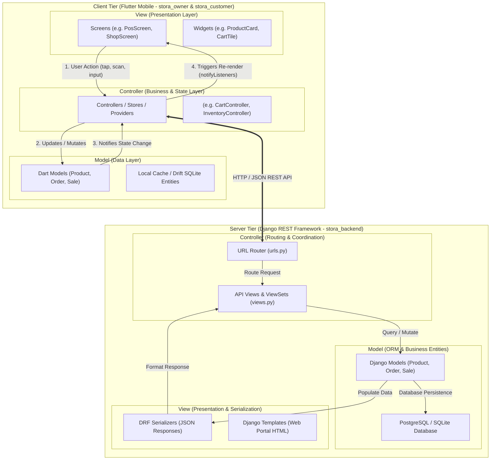
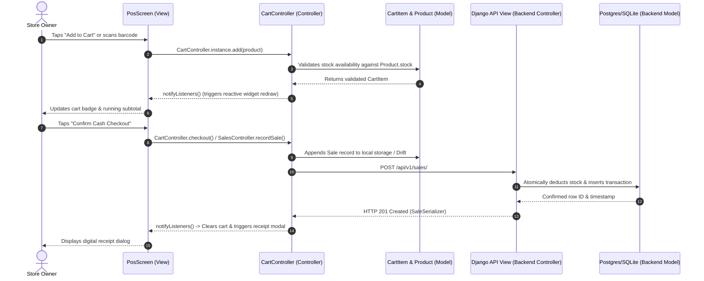

# Stora Architecture & MVC Specification

## 1. Executive Summary

**Stora** adheres strictly to the **Model-View-Controller (MVC)** architectural pattern across both its client applications (Flutter mobile clients) and its backend services (Django REST Framework). 

By enforcing a clear separation of concerns, Stora ensures:
- **Modularity**: Data persistence, business rules, and UI presentations are decoupled.
- **Maintainability**: Business logic and state mutations can be refactored or unit-tested without touching UI widgets.
- **Offline Resilience**: Mobile controllers seamlessly negotiate between local offline SQLite/Drift stores and cloud REST endpoints.

---

## 2. Global Architectural Overview

---

## 3. Subsystem Breakdown

### 3.1. Flutter Customer App (`stora_customer`)

| MVC Component | Directory / Artifact | Role & Responsibility |
| :--- | :--- | :--- |
| **Model** | `lib/models/` | Immutable data entities (`Product`, `Order`, `Store`, `CartItem`, `User`). Handles JSON parsing (`fromJson`), serializing (`toJson`), and formatting. |
| **View** | `lib/screens/` `lib/widgets/` | Pure presentation UI. Renders widgets, receives gestures, and triggers controller actions. Examples: `ShopScreen`, `CartScreen`, `OrdersScreen`, `ProductCard`. |
| **Controller** | `lib/controllers/` `lib/providers/` | Manages feature workflows, API networking, and UI reactive state extending `ChangeNotifier`. Examples: `CartController`, `CatalogController`, `OrderController`, `AuthController`. |

### 3.2. Flutter Owner App (`stora_owner`)

| MVC Component | Directory / Artifact | Role & Responsibility |
| :--- | :--- | :--- |
| **Model** | `lib/home/models/` `lib/data/local/` | Domain representations of business entities (`Product`, `Sale`, `CartItem`, `PaymentAccount`, `OwnerNote`) and local Drift/SQLite schema tables. |
| **View** | `lib/home/screens/` `lib/home/widgets/` `lib/stora_login/` | Store owner UI interfaces. Displays sales graphs, POS barcode scanner, inventory tables, and utang ledgers. Examples: `PosScreen`, `InventoryListScreen`, `DashboardScreen`. |
| **Controller** | `lib/home/controllers/` `lib/home/stores/` `lib/data/stores/` | Orchestrates offline-first mutations, calculations (totals, debt balance, daily earnings), and sync triggers. Examples: `CartController`, `InventoryController`, `SalesController`, `UtangController`, `OrdersController`. |

### 3.3. Django Backend (`stora_backend`)

In Django's Model-View-Template (MVT) architecture (which maps 1:1 to MVC):

| MVC Component | Backend Implementation | Role & Responsibility |
| :--- | :--- | :--- |
| **Model** | `*/models.py` (`accounts`, `api`, `inventory`, `orders`, `sales`) | Defines relational tables, constraints, validation methods, foreign keys, and DB transactions. |
| **View** | `api/serializers.py` `templates/` | Defines how data is represented to clients: serializes model instances into JSON payloads for mobile apps, or renders HTML templates for web admins. |
| **Controller** | `urls.py` `api/views.py` | URL dispatcher maps incoming endpoints. ViewSets/APIViews authenticate requests, invoke business methods on models, and select the appropriate view serializer. |

---

## 4. MVC Lifecycle Example: POS / Cart Checkout

---

## 5. Architectural Quality Guarantees

1. **Strict Separation of Concerns**: Views do not make raw SQL queries or execute untracked HTTP requests; all mutations flow through the respective Controllers.
2. **First-Class MVC Aliases**: The Flutter codebases expose dedicated `lib/controllers/` modules, allowing seamless integration with traditional MVC naming conventions while maintaining full compatibility with Flutter `Provider` and `ChangeNotifier` state architectures.
3. **Decoupled Testing**: Controllers and Models can be tested independently of Flutter widget rendering lifecycles and backend web servers.
