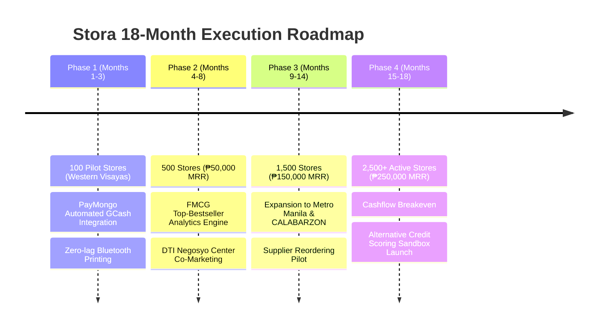
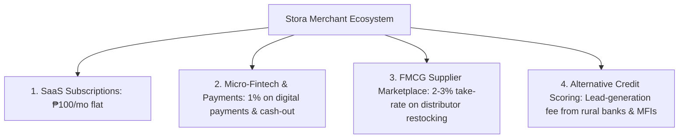

# STORA: Smart Inventory & Micro-Commerce Platform
## Investor Pitch & Proposed Use of Funds
**Document Type:** Investor Memorandum & Financial Ask Breakdown  
**Target Sector:** MSME Digitalization & FinTech (Sari-Sari Stores, Micro-Retailers)  
**Stage:** Pre-Seed / Commercialization Stage (Post-MVP, Live Working Applications)  
**Target Geography:** Philippines (Western Visayas Pilot ➔ Metro Manila & CALABARZON Expansion)  
**Valuation Instrument:** SAFE (Simple Agreement for Future Equity) or Equity / Equity-Free Matching Grant  

---

## 1. Executive Summary: The Investment Opportunity

### The Problem
There are **1.3 million neighborhood sari-sari stores** and micro-retailers in the Philippines generating over **$10B+ USD in annual FMCG transactions**, yet **90%+ still operate using manual paper notebooks ("talaan") or memory**. Commercial POS systems (Utak, StoreHub, Mosaic) cost ₱15,000–₱40,000 in upfront hardware and ₱1,500+/month with strict credit card requirements—excluding 99% of grassroots entrepreneurs.

### The Solution: STORA
Stora turns any Android smartphone into an enterprise-grade retail terminal:
- **Zero-Hardware POS:** Smartphone camera barcode scanning, instant *sukli* (change) calculation, and receipting.
- **Offline-Resilient Local Storage (Drift/SQLite):** Zero downtime during power outages or intermittent rural mobile data.
- **Digital Utang Ledger (Listahan):** Automated tracking of community debt with customizable *patong* (penalties) and SMS payment reminders.
- **Micro-Commerce & Local Store Radar:** GPS geolocation discovery for customers, in-app ordering, GCash/InstaPay QR integration, and bilateral chat.
- **Working Prototype Status:** Both `Stora Owner` and `Stora Customer` apps are fully engineered, tested, and operational with live backend APIs.

---

## 2. The Ask (Capital Requirement & Deal Structure)

| Parameter | Recommended Primary Ask (Pre-Seed) | Alternative Tranche (Grant/Pilot Matching) |
|---|---|---|
| **Capital Target** | **₱2,000,000 PHP** (~$35,000 USD) | **₱1,000,000 PHP** (~$18,000 USD) |
| **Operational Runway** | **18 Months** | **12 Months** |
| **Investment Instrument** | SAFE (Post-Money Valuation Cap) or Equity | Pre-Seed Convertible / Grant Matching |
| **Target Valuation Cap** | ₱18,000,000 – ₱20,000,000 PHP (~$320k–$350k USD) | Negotiable / Milestone-Based |
| **Target Milestone** | **2,500 Paid Stores** (₱250k MRR / ₱3M ARR) | **1,000 Paid Stores** (₱100k MRR / ₱1.2M ARR) |

---

## 3. Proposed Use of Funds Breakdown

```
       PROPOSED ALLOCATION OF ₱2,000,000 SEED CAPITAL
 ┌────────────────────────────────────────────────────────┐
 │ [35%] Product, Engineering & Cloud Infrastructure      │ ₱700,000
 │ [30%] Merchant Acquisition & Grassroots Field GTM      │ ₱600,000
 │ [15%] Operations, Merchant Success & Support            │ ₱300,000
 │ [10%] Legal, Regulatory (NPC/DPA) & Fintech Licensing   │ ₱200,000
 │ [10%] Contingency & Working Capital Reserve            │ ₱200,000
 └────────────────────────────────────────────────────────┘
```

### Detailed Itemized Allocation

| Category | Budget (PHP) | Share (%) | Deliverables & Milestones |
|---|---|---|---|
| **1. Product, Engineering & Cloud** | **₱700,000** | **35.0%** | • Automated payment gateway integrations (PayMongo/Xendit) for recurring GCash/Maya billing.<br>• Cloud auto-scaling (PostgreSQL, Redis caching, AWS/DigitalOcean) supporting 100,000 daily transactions.<br>• Telemetry, encrypted offline sync reconciliation, and Bluetooth thermal printer SDK library.<br>• Developer stipend/allowance for 3 core engineers (Mobile, Backend, DevOps) over 12 months. |
| **2. Merchant Acquisition & Field GTM** | **₱600,000** | **30.0%** | • **Field Sales Ambassadors:** 3 on-the-ground reps onboarded in high-density sari-sari store clusters (Iloilo, Cavite, Quezon City).<br>• **Merchant Welcome Kits:** 1,500 acrylic QR standees, Stora store window stickers, and starter manual booklets (₱150/kit = ₱225,000).<br>• **Barangay Retail Clinics:** Direct community onboarding workshops partnering with local cooperatives and DTI Negosyo Centers.<br>• **Hyperlocal Digital Ads:** Targeted Facebook and TikTok campaigns targeting micro-entrepreneurs. |
| **3. Operations & Merchant Success** | **₱300,000** | **15.0%** | • Dedicated merchant support rep (Bilingual Hiligaynon/Tagalog) handling live chat and troubleshooting.<br>• Automated SMS notification credits (Semaphore/Twilio for *Utang* reminders and order alerts).<br>• Device testing lab (4 low-spec budget Android test phones running Android 9–14). |
| **4. Legal, Compliance & Partnerships** | **₱200,000** | **10.0%** | • SEC corporation incorporation, DTI registration, and BIR business permits.<br>• Data Privacy Act (DPA 2012) and National Privacy Commission (NPC) compliance audit.<br>• Legal retainers for merchant terms of service, FMCG data policy, and fintech partnership agreements. |
| **5. Working Capital & Contingency Reserve** | **₱200,000** | **10.0%** | • 18-month financial buffer against unexpected cloud spikes, exchange rate fluctuations, and pilot deployment delays. |
| **TOTAL** | **₱2,000,000** | **100.0%** | **18-Month Operational Runway to Cashflow Breakeven** |

---

## 4. Key Milestones & Growth Roadmap (18-Month Runway)



### Milestone Targets Table
| Milestone Period | Target Active Stores | Target Paying Stores | Monthly Recurring Revenue (MRR) | Cumulative GMV Processed |
|---|---|---|---|---|
| **Month 3 (Pilot Validation)** | 250 stores | 100 stores | ₱10,000 / mo | ₱1,500,000 |
| **Month 6 (Traction)** | 750 stores | 400 stores | ₱40,000 / mo | ₱6,000,000 |
| **Month 12 (Scale)** | 2,000 stores | 1,200 stores | ₱120,000 / mo | ₱25,000,000 |
| **Month 18 (Breakeven/Series A Ready)** | **4,500 stores** | **2,500 stores** | **₱250,000 / mo** (₱3.0M ARR) | **₱65,000,000+** |

---

## 5. Unit Economics & Investor ROI Metrics

The grassroots micro-SaaS model is backed by defensible unit economics:

```
  ┌─────────────────────────────────────────────────────────┐
  │ Customer Acquisition Cost (CAC)         : ₱280 PHP      │
  │ Monthly Subscription Price (ARPU)       : ₱100 PHP/mo   │
  │ Average Merchant Retention              : 22 Months     │
  │ Lifetime Value (LTV)                    : ₱2,200 PHP    │
  │ LTV : CAC Ratio                         : 7.8x          │
  │ Payback Period                          : 2.8 Months    │
  └─────────────────────────────────────────────────────────┘
```
*(Benchmark: A venture-backed SaaS company aims for LTV:CAC > 3.0x and Payback < 12 months. Stora outperforms due to organic community word-of-mouth and low-cost field onboarding).*

---

## 6. Long-Term Monetization Levers (The Billion-Dollar FinTech Upside)

While the initial ask is predicated on SaaS subscriptions, Stora's multi-layered business model unlocks exponential revenue streams once store density is achieved:



1. **SaaS Micro-Subscriptions (Current Foundation):**
   - ₱100/month or ₱1,000/year flat for unlimited inventory, analytics exports, and cloud backups.
2. **FMCG Brand Intelligence & In-App Restocking (Marketplace):**
   - Sari-sari stores currently travel to physical wholesalers 2–3 times a week. Stora aggregates neighborhood product demand (e.g., 500 cases of Coca-Cola or Tide sachets across 50 stores in Pototan), earning a **2%–3% brokerage commission** on direct distributor drop-shipping.
3. **Alternative Credit Scoring & Micro-Loans:**
   - Sari-sari store owners rely on loan sharks ("5-6" charging 20% monthly interest). Stora's tamper-proof POS and Utang records generate an algorithmic credit score, allowing partner rural banks and microfinance institutions (MFIs) to issue working capital loans, with Stora taking a **1.5% origination fee**.
4. **Digital Payments & Cash-Out Convenience:**
   - In-app utility bills payment, mobile load dispensing, and neighborhood cash-in/cash-out commissions.

---

## 7. Competitive Moat: Why Stora Wins

| Dimension | Traditional POS (Utak, StoreHub) | Spreadsheet / Paper Talaan | STORA |
|---|---|---|---|
| **Upfront Cost** | ₱15,000 – ₱40,000 (Hardware) | ₱50 (Notebook) | **₱0 (Runs on existing smartphone)** |
| **Monthly Cost** | ₱1,000 – ₱3,000 / month | ₱0 | **₱100 / month flat** |
| **Payment Method** | Credit Card / Bank Wire | N/A | **GCash / Maya Native** |
| **Offline Resilience** | Drops when internet fails | Offline manual | **100% Offline-First (Local Drift DB)** |
| **Credit Tracking** | Complex or absent | Lost/Torn paper | **Automated Utang Ledger + SMS Reminders** |
| **Customer App** | None (POS only) | None | **Bilateral Customer Discovery & Orders** |

---

## 8. Summary Pitch for Investors

> *"Sari-sari stores power 65% of the Philippine retail economy, yet they have been completely ignored by enterprise POS software that requires expensive iPads and credit cards.*  
>  
> *With Stora, we are building the digital operating system for the 1.3 million Filipino micro-retailers. We have built and validated the full ecosystem—from offline barcode scanning and automated change calculators to digitized Utang management and real-time customer ordering.*  
>  
> *With an ask of **₱2,000,000 PHP ($35,000 USD)**, we will fund an **18-month runway to onboard 2,500 paying merchants**, achieve **₱250,000 in monthly recurring revenue**, and position Stora as the definitive retail and data infrastructure for grassroots Philippine commerce."*
