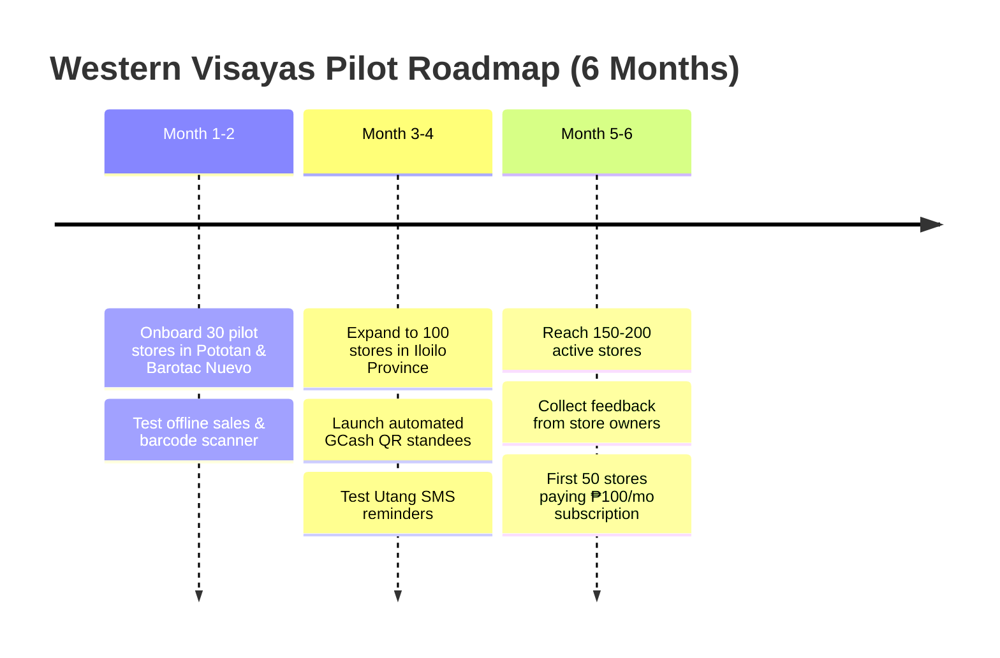

# STORA: Smart Inventory & Micro-Commerce Platform
## Beginner-Friendly Startup Pitch & Proposed Use of Funds
**Target Sector:** Micro, Small & Medium Enterprises (MSMEs) & Sari-Sari Stores  
**Focus Region:** Western Visayas (Region VI — Iloilo, Panay Island)  
**Target Program:** DICT Philippine Startup Challenge XI (PSC XI) / Regional Incubation & Angel Grants  
**Stage:** Early Stage / Working Prototype (Post-MVP Ready for Field Pilot)  

---

## 1. Simple Pitch (What is Stora in Plain Words?)

> **"In Western Visayas, thousands of neighborhood sari-sari store owners still write their daily sales and utang (credits) in paper notebooks called 'talaan'. When the notebook gets lost, wet, or miscalculated, the store loses money.**  
>  
> **Commercial POS systems cost ₱15,000 to ₱40,000 and require credit cards that our local nanays and tatays don't have.**  
>  
> **Stora is a free, beginner-friendly mobile app that turns any ordinary Android phone into a digital cash register. Store owners can scan barcodes with their camera, calculate sukli (change) automatically, track who owes utang with automatic SMS reminders, and accept GCash without buying any expensive equipment."**

---

## 2. The Ask: Realistic & Beginner-Friendly

Instead of asking for millions of pesos right away, we are proposing a realistic, grounded **Seed / Grant Ask** designed specifically for a focused pilot in **Western Visayas**:

### 🎯 Primary Funding Ask: **₱250,000 PHP** (~$4,500 USD)
* **Runway:** **6 to 8 Months** of live field testing and deployment.
* **Target Milestone:** Onboard **150 to 200 active sari-sari stores** across Iloilo (Pototan, Barotac Nuevo, Dingle, Jaro, and Iloilo City).
* **Funding Model:** DICT Startup Grant / School Incubation / Local Angel Investors (SAFE or Milestone Grant).

*(Option: If applying strictly for the DICT PSC XI initial pilot tranche, this can be streamlined to **₱175,000 PHP** as detailed in our original concept note).*

---

## 3. Proposed Use of Funds (Where Every Peso Goes)

Here is a transparent, realistic breakdown of how the **₱250,000 PHP** will be spent:

```
          PROPOSED USE OF FUNDS (₱250,000 PHP BUDGET)
 ┌────────────────────────────────────────────────────────┐
 │ [35%] Field Onboarding & Merchant Kits in Iloilo        │ ₱87,500
 │ [25%] Cloud Hosting, Database & SMS Credits            │ ₱62,500
 │ [25%] Team Connectivity, Testing Phones & Allowance    │ ₱62,500
 │ [15%] DTI Registration, Permits & Emergency Buffer     │ ₱37,500
 └────────────────────────────────────────────────────────┘
```

### Detailed Itemized Budget Table

| Budget Category | Amount (PHP) | Share (%) | What This Pays For |
|---|---|---|---|
| **1. Field Onboarding & Merchant Kits** | **₱87,500** | **35.0%** | • **150 Laminated QR Standees & Store Decals:** Printing acrylic GCash standees for stores (₱120 each = ₱18,000).<br>• **Iloilo Field Travel:** Gas and fare for visiting stores in Pototan, Barotac Nuevo, Dingle, and Iloilo City.<br>• **Barangay Onboarding Sessions:** Simple snacks and materials for 5 community demo sessions teaching nanays how to use the app.<br>• **Starter Guide Booklets:** Easy, illustrated Hiligaynon/Tagalog quick-start manuals. |
| **2. Cloud Hosting, Database & SMS** | **₱62,500** | **25.0%** | • **Cloud Server & Database (8 Months):** Hosting our Django backend & PostgreSQL database online (Render/DigitalOcean at ~₱1,800/month).<br>• **Image Storage (Cloudinary):** Fast loading for uploaded product photos.<br>• **SMS Credits (Semaphore API):** 4,000 SMS credits so store owners can send automated payment reminders for *utang*.<br>• **Google Play Console License:** One-time ₱1,500 registration fee to publish the APK on the Play Store. |
| **3. Team Allowance & Test Devices** | **₱62,500** | **25.0%** | • **2 Budget Android Test Phones (₱9,000):** Testing the app on real entry-level phones (like Realme / Redmi) used by actual local store owners to ensure zero lag.<br>• **Internet & Work Allowance:** Wi-Fi and load allowance for the student developer team during the 6-month deployment. |
| **4. Permits, Legal & Emergency Buffer** | **₱37,500** | **15.0%** | • **Business Registration:** DTI business name registration and local barangay permits.<br>• **Contingency Buffer:** Emergency reserve for unexpected cloud costs or emergency app maintenance. |
| **TOTAL** | **₱250,000** | **100.0%** | **Full 6 to 8-Month Western Visayas Pilot Runway** |

---

## 4. Realistic Milestones for Western Visayas

We are keeping our milestones simple and focused on our home region:



| Timeline | Area Covered | Target Stores | Key Achievement |
|---|---|---|---|
| **Months 1 – 2** | Pototan & Barotac Nuevo | **30 Stores** | Test offline barcode scanning and verify that daily sales match real cash. |
| **Months 3 – 4** | Dingle, Passi & Central Iloilo | **100 Stores** | Deploy acrylic QR standees and validate digital *utang* reminders via SMS. |
| **Months 5 – 6** | Metro Iloilo & Neighboring Towns | **150 – 200 Stores** | Validate the ₱100/month subscription model with at least 40–50 paying stores. |

---

## 5. How Stora Makes Money (Simple Business Model)

1. **Free Forever Plan (₱0):**
   * Up to 20 products, offline cash register, barcode scanner, and automatic change (*sukli*) calculator.
   * *Why?* To get store owners to trust the app without paying anything upfront.
2. **Premium Store Plan (₱100 / month via GCash):**
   * Unlimited products, sales charts, low-stock warnings, and digital debt (*utang*) reminders.
   * *Why ₱100?* It costs less than a single soft drink per week, making it affordable for any sari-sari store.
3. **Future Goal in Western Visayas:**
   * **100 paying stores** = ₱10,000 / month recurring revenue.
   * **500 paying stores** in Panay Island = ₱50,000 / month recurring revenue (covers all cloud and team costs).

---

## 6. 1-Minute Pitch Script for DICT PSC XI Judges

> *"Good day, judges and investors!*  
>  
> *Here in Western Visayas, our local sari-sari stores are the lifeblood of our barangays. But our nanays and tatays still use paper notebooks to track their sales and utang. When notebooks get wet or torn, they lose their hard-earned money.*  
>  
> *That’s why we built **STORA**.*  
>  
> *Stora is a lightweight mobile app designed specifically for Filipino micro-stores. Using just their existing smartphone, store owners can scan barcodes, compute sukli automatically, track customer utang with friendly reminders, and show their GCash QR code to walk-in buyers.*  
>  
> *Today, our app is already built and working. We are asking for **₱250,000 PHP** to fund an 8-month pilot across Iloilo. This will pay for physical QR standees for 150 stores, essential cloud hosting, and on-the-ground onboarding workshops.*  
>  
> *Help us bring digital inclusion to Western Visayas, one sari-sari store at a time. Thank you!"*
