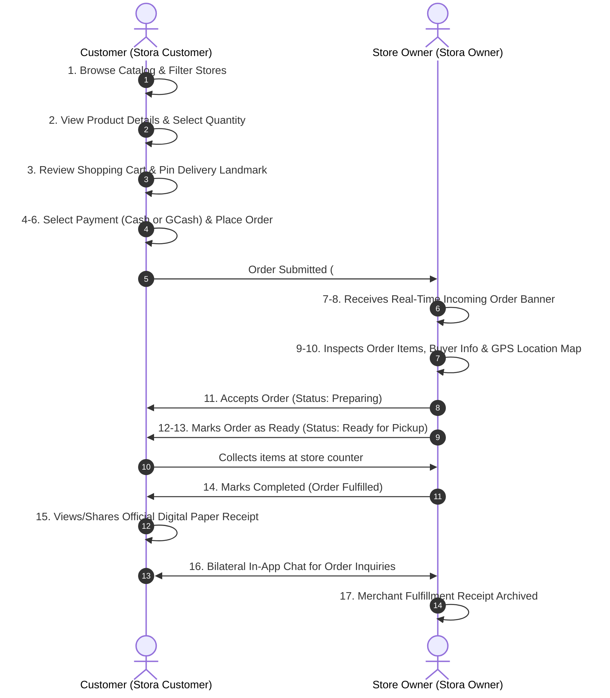

# STORA: Smart Inventory & Micro-Commerce Platform
## Comprehensive User Guide & Screen-by-Screen Documentation
**Target Platform:** Mobile (Android / iOS) & Cloud Backend  
**Target Sector:** MSME Digitalization & FinTech (Sari-Sari Stores, Micro-Retailers, Community Vendors)  
**Document Purpose:** User Manual, System Process Verification & Technical Feature Documentation

---

# PART 1: Online Customer Process (End-to-End Workflow)
*A complete 17-step walkthrough detailing how a customer browses products, places an online store order, and how the merchant reviews, prepares, fulfills, and receipts the transaction with live bilateral synchronization.*

---

### Step 1: Multi-Store Catalog & Discovery (Customer Home)
- **Application:** `Stora Customer`
- **Screen:** Home Screen (`Browse Stores`)
- **Key Interface Elements:**
  - Header with personalized greeting (`Hi, Lejon Osial`), quick cart shortcut with badge counter.
  - Search bar supporting product name and barcode search.
  - Horizontal category chips (`All Categories`, `Crochet`, `Dress`, `Drinks`, `Snacks`, etc.).
  - "Available Stores" carousel displaying currently open local stores (e.g., *khai store*, *Mikay's Crochet*) with active indicator dots.
  - "All Items" product grid displaying multi-store catalog items, dynamic stock badges (`89 in stock`), unit prices in Philippine Peso (`₱20.00`, `₱45.00`), and one-tap `+ Add` buttons.
- **Description & Action:** The customer discovers local stores and items across multiple merchants in one unified feed. Tapping an item opens the item detail modal; tapping a store card opens that specific store's branded catalog.

---

### Step 2: Product Detail & Add-to-Cart Modal
- **Application:** `Stora Customer`
- **Screen:** Product Detail Bottom Sheet (`Honey Butter`)
- **Key Interface Elements:**
  - High-resolution product image presentation.
  - Category tag (`SNACKS`) and originating store identifier (`Ljam Store`).
  - Pricing display (`₱45.00`) and high-contrast stock indicator (`93 in stock` with green live dot).
  - Interactive Quantity Stepper (`-` / `+`) with available inventory threshold limit.
  - Action buttons: Direct `Chat` button (inquire with seller) and prominent orange `Add to Cart • ₱45.00` button.
  - Safety/moderation shortcut: `Report this product` link.
- **Description & Action:** The customer views granular product information, confirms stock availability, adjusts purchase quantities, and adds the product directly to their active shopping cart.

---

### Step 3: Shopping Cart Review & Delivery Landmark
- **Application:** `Stora Customer`
- **Screen:** Cart Screen (`My Shopping Cart`)
- **Key Interface Elements:**
  - Store grouping header (`Store: Ljam Store`) ensuring single-merchant fulfillment integrity.
  - Customer Landmark/Location display (`SRNH, Sterling Homes, Pototan, Iloilo`) with GPS locator icon.
  - Cart line items with thumbnail, unit price, quantity modifier, subtotal (`₱45.00`), and quick delete trash icon.
  - Bottom summary bar indicating total item count and cumulative subtotal.
  - Primary call-to-action: `Proceed to Checkout` button.
- **Description & Action:** The customer reviews their cart contents, verifies that the delivery address/landmark is accurate, adjusts quantities if necessary, and proceeds to the checkout flow.

---

### Step 4: Checkout Order — Cash on Pickup Selection
- **Application:** `Stora Customer`
- **Screen:** Checkout Configuration Screen
- **Key Interface Elements:**
  - Store identification banner (`Ordering from Ljam Store`).
  - Payment Method Radio Selector:
    - `Cash on Pickup / In-Store` (Selected): "Pay with cash upon collecting your order at the store."
    - `Online Payment (Verified)`: "Pay via GCash • Transfer after acceptance."
  - Fulfillment Mode Notice: `In-Store Pickup Only` badge explaining counter pickup terms.
  - Customer & Pickup Information form: Customer Full Name, Contact Phone Number (`09702943869`), and physical Landmark.
- **Description & Action:** Allows the buyer to choose cash-based transactions upon arrival. Contact details are pre-filled from their profile to eliminate typing friction.

---

### Step 5: Checkout Order — Online Payment (GCash & Store QR)
- **Application:** `Stora Customer`
- **Screen:** Checkout Configuration Screen (Online Payment active)
- **Key Interface Elements:**
  - `Online Payment (Verified)` method selected.
  - Trust Banner: `Safe Ordering: No Advance Payment Needed` ("You do NOT need to pay right now! Place your order first. You only transfer payment once the store reviews and confirms your order.").
  - Merchant Payment Card: Verified GCash account name (`Lejon B. Osial`), mobile account number (`09944390837`) with one-tap `Copy` button, and thumbnail preview of the merchant's payment QR code (`Tap to enlarge and scan QR`).
- **Description & Action:** Provides transparent cashless payment details. Protects customers from sending money before the merchant verifies real stock availability.

---

### Step 6: Checkout Order — Pickup Notes & Order Submission
- **Application:** `Stora Customer`
- **Screen:** Checkout Order Review & Submit
- **Key Interface Elements:**
  - Optional `Pickup Notes / Instructions` text field (e.g., *"Will pick up around 4 PM, please pack in paper bag"*).
  - Itemized `Order Summary` (`1x Honey Butter ₱45.00`).
  - Total summary line (`Total Amount ₱45.00`).
  - Full-width submission button: `Place Order (₱45.00)`.
- **Description & Action:** The customer inputs special instructions for the store owner, does a final price review, and submits the order into the real-time processing queue.

---

### Step 7: Order Tracking — Placed & Awaiting Store Response
- **Application:** `Stora Customer`
- **Screen:** Orders Tracker (`My Orders` -> `Pending` tab)
- **Key Interface Elements:**
  - Order card header: `Order #39` with date/timestamp (`Oct 7, 2026 • 5:47 PM`) and status pill `Pending`.
  - Visual 4-Step Pipeline: **Placed (✓ Active)** ➔ **Accepted** ➔ **Preparing** ➔ **Ready**.
  - Pipeline status note: `Awaiting Store Response`.
  - Recorded pickup details, chosen payment method, total cost (`₱45.00`), `Chat`, `Cancel`, and `Report` buttons.
- **Description & Action:** Provides the customer with real-time feedback that their order has reached the merchant's device and is waiting for merchant confirmation.

---

### Step 8: Merchant Dashboard — Incoming Order Notification Alert
- **Application:** `Stora Owner`
- **Screen:** Home Dashboard (`Hi, Ljam Store`)
- **Key Interface Elements:**
  - Dynamic status banner: `1 Incoming Order - NEW` ("Tap to review, accept, or counter-offer >").
  - `Store is OPEN` toggle showing active online order intake.
  - Metrics cards: Today's Total Earnings (`₱210.00`), Customer Utang/Credit (`₱40.00`), and quick navigation bar.
- **Description & Action:** When an order is placed, the store owner's dashboard instantly flags the incoming transaction via real-time sync, alerting the merchant to review and act immediately.

---

### Step 9: Merchant Order Review & Decision
- **Application:** `Stora Owner`
- **Screen:** Orders Management (`Customer Orders` -> `Active / Pending` tab)
- **Key Interface Elements:**
  - Order card header: `Order #39`, badge `PENDING REVIEW`, total amount (`₱45.00`).
  - Customer information panel: Avatar, Full Name (`Lejon Osial`), Email, Phone (`09702943869`), Landmark address with `View Map` button.
  - Item list breakdown: `1x Honey Butter` (`₱45.00 each`).
  - Decision action trio:
    - `Decline` (Reject if out of stock).
    - `Counter` (Propose substitute item or price adjustment).
    - `Accept Order` (Prominent green primary action).
- **Description & Action:** The merchant inspects who is ordering, where they are located, and what items are requested. The merchant can accept the order or communicate modifications.

---

### Step 10: Merchant Spatial Navigation & Customer Location Map
- **Application:** `Stora Owner`
- **Screen:** Map Modal (`Delivery Location • Order #39`)
- **Key Interface Elements:**
  - Vector map overlay plotting both the merchant's physical location (`Your Store`) and customer's pickup landmark (`Lejon Osial`).
  - Road routing path connecting store to buyer coordinates in Pototan, Iloilo.
  - One-tap quick actions: `Start Road Navigation` (launches turn-by-turn routing), direct `Call` shortcut, and `Message customer about this order`.
- **Description & Action:** Tapping "View Map" gives the store owner immediate spatial awareness of the customer's proximity, enabling delivery coordination or estimation of customer arrival time for pickup.

---

### Step 11: Merchant Preparation & "Mark as Ready"
- **Application:** `Stora Owner`
- **Screen:** Orders Management (`Customer Orders`)
- **Key Interface Elements:**
  - Order card status updated to `ACCEPTED (PREPARING)`.
  - Action buttons refreshed to:
    - `Receipt` (Green icon button to view digital slip).
    - `Mark as Ready` (Green primary button).
- **Description & Action:** Having accepted the order, the merchant packages the ordered items at the store counter. Once bagged and ready, tapping "Mark as Ready" sends an instant notification to the customer.

---

### Step 12: Merchant Ready for Pickup & "Complete Order"
- **Application:** `Stora Owner`
- **Screen:** Orders Management (`Customer Orders`)
- **Key Interface Elements:**
  - Status pill updated to `READY FOR PICKUP`.
  - Action buttons refreshed to:
    - `Receipt` (Quick receipt viewer).
    - `Complete Order` (Prominent checkmark button).
- **Description & Action:** The order sits at the pickup counter. When the customer arrives, verifies their identity, and receives their package, the merchant taps "Complete Order" to close the transaction.

---

### Step 13: Customer Notification — Order Ready for Pickup
- **Application:** `Stora Customer`
- **Screen:** Orders Tracker (`My Orders`)
- **Key Interface Elements:**
  - Status pipeline advanced: **Placed (✓)** ➔ **Accepted (✓)** ➔ **Preparing (✓)** ➔ **Ready (✓)**.
  - Success banner: `Your order is prepared and ready for pickup at the store! 🎉`.
  - Quick access buttons: View digital receipt, chat with seller, or report order.
- **Description & Action:** The customer receives live UI feedback that their goods are packaged and waiting at the counter, prompting them to walk over and collect their purchase.

---

### Step 14: Customer Order Completed Confirmation
- **Application:** `Stora Customer`
- **Screen:** Orders Tracker (`My Orders`)
- **Key Interface Elements:**
  - Status pill updated to `Completed`.
  - Pipeline completely fulfilled: **Placed (✓)** ➔ **Accepted (✓)** ➔ **Preparing (✓)** ➔ **Completed (✓)**.
  - Completion notification banner: `Order Completed! 🎉 Thank you for purchasing from Ljam Store. Your order has been fulfilled successfully!`.
  - Post-order action buttons: `Chat`, `Reorder` (orange one-tap re-cart button), and `Receipt`.
- **Description & Action:** Confirms successful fulfillment. Historical order records remain saved in the customer's account with one-tap re-ordering for repeat purchases.

---

### Step 15: Customer Digital Paper Receipt
- **Application:** `Stora Customer`
- **Screen:** Official Digital Receipt Modal
- **Key Interface Elements:**
  - Realistic paper receipt aesthetic with store branding (`LJAM STORE - OFFICIAL RECEIPT`).
  - Audit metadata: Receipt Number (`ORD-39`), Date/Time (`Oct 07, 2026 • 05:47 PM`), Order Number, Order Type (`Online Order`), Customer Name (`Lejon Osial`), and Status (`Completed`).
  - Line items breakdown: `1x Honey Butter @ ₱45.00`.
  - Summary: Total Items (1), Total Amount (`₱45.00`).
  - Utility actions: `Share` (sends digital receipt via messaging/social apps) and `Print` (connects to Bluetooth thermal printers or system printer).
- **Description & Action:** Provides the customer with a legally transparent digital proof of purchase without wasting paper, which can be printed or exported as an image/PDF.

---

### Step 16: Direct In-App Bilateral Chat
- **Application:** Both (`Stora Customer` & `Stora Owner`)
- **Screen:** Order Chat Screen (`Active Order Chat`)
- **Key Interface Elements:**
  - Header: Counterpart name (`Lejon Osial`), linked order identifier banner (`Order #39 - Active Order Chat`).
  - Pre-built quick reply chips (e.g., *"Hello! How can I help you today?"*, *"Your order is prepared"*).
  - Multimodal messaging input bar: text input, camera snapshot, photo gallery upload, and lightning quick actions.
- **Description & Action:** Enables secure, direct, in-app messaging between store owner and shopper for pickup coordination, product queries, or payment confirmations without needing third-party chat apps.

---

### Step 17: Merchant Official Fulfillment Receipt
- **Application:** `Stora Owner`
- **Screen:** Official Digital Receipt Modal (Merchant View)
- **Key Interface Elements:**
  - Identical official digital store receipt for `Order #39`.
  - Itemized total (`₱45.00`), customer name, and `Completed` badge.
  - Action buttons: `Share` and `Print`.
- **Description & Action:** Enables the merchant to print a physical thermal receipt for the customer or keep digital accounting records for tax and book-keeping purposes.

---

# PART 2: Stora Features & Stora Customer Ecosystem
*A comprehensive guide covering all merchant management modules (Utang Ledger, POS, Inventory, Analytics, Settings) and customer-facing discovery and navigation screens.*

---

### Module 1: Merchant Home Dashboard (Overview & Quick Actions)
- **Screens:** Dashboard Top View & Dashboard Bottom View
- **Application:** `Stora Owner`
- **Key Features & Indicators:**
  - **Online Store Toggle:** Single-tap switch to open or close the store to online customer orders (`Store is OPEN` / `Store is CLOSED`).
  - **Dynamic Order Banner:** Real-time indicator alerting to pending customer orders.
  - **Financial Metrics Card:** Today's Total Earnings (`₱210.00` - `₱255.00`), sales count, average transaction value, and growth trend badge (`+100%`).
  - **Utang / Credit Summary Widget:** Displays total uncollected receivables (`Total Collectible ₱40.00` - `₱67.00`) and active borrower count.
  - **Quick Action Grid:**
    - `Payment QR Sign`: Opens digital GCash/Maya QR standee.
    - `Business Insights`: Opens AI-driven store tips.
    - `Store Map`: Quick access to GPS location pinning.
    - `Sales Analytics & Reports`: Navigates to performance charts.
  - **Stock Counter Pills:** Real-time stock counts: `In stock (566 - Healthy)` and `Low stock (0 - Action)`.
  - **Floating/Quick Buttons:** `New Sale` (opens POS) and `Add Product` (opens product creator).

---

### Module 2: Transaction History & Financial Audit
- **Screen:** Sales History Screen
- **Application:** `Stora Owner`
- **Key Features & Indicators:**
  - Search bar filtering transactions by customer name, receipt number, product, or note.
  - Period filter pills: `All Time`, `Today`, `This Month`, and Custom Date Picker.
  - Cumulative metrics banner: All-Time Revenue (`₱1,790.00` - `₱2,540.00`) and Total Sales Count (`35` - `46`).
  - Differentiated transaction tags: `Online Order` vs `In-Store` POS vs `Utang • Unpaid`.
  - Each entry displays timestamp, customer name, receipt number, itemized items, transaction amount, and direct `Receipt` viewing button.

---

### Module 3: Digital Utang Ledger (Listahan) & Credit Management
- **Screens:** Empty State ➔ Entry Creation ➔ Penalty (Patong) Configuration ➔ Active Ledger List
- **Application:** `Stora Owner`
- **Key Features & Indicators:**
  - **Digitized Paper Listahan:** Eliminates lost or torn paper notebooks with a tamper-resistant digital ledger.
  - **Lifecycle Status Tabs:** `Active`, `Overdue`, `Due Soon`, and `Paid`.
  - **Customer Entry Form:** Records Customer Name, optional Mobile Number, Total Borrowed Amount, and customizable Payment Due Date.
  - **Flexible Late Penalty (Patong) System:**
    - `None`: No penalty even past the due date (*Walang penalty*).
    - `Per Day`: Daily compounding late fee.
    - `Per Week`: Weekly penalty charge.
    - `Per Month`: Monthly recurring interest rate.
  - **Collection Actions:**
    - `Remind`: Sends an automated SMS/notification reminder to the customer.
    - `Pay`: Records partial or complete settlement of the loan.
  - **Health Indicators:** Status tags like `CURRENT` (green) or `OVERDUE` (red).

---

### Module 4: Owner Notes, Reminders & Task Pinning
- **Screens:** Empty State ➔ Note Creator ➔ Active Notes List ➔ Dashboard Pinned Note
- **Application:** `Stora Owner`
- **Key Features & Indicators:**
  - **Categorized Store Memos:** Categorize tasks under `Reminder`, `Restock`, `To-Do`, or `Payment`.
  - **Dialect / Local Language Friendly:** Seamless support for regional terms (e.g., *"Balaklon"* — Hiligaynon for *items to buy*).
  - **Automated Scheduling:** Preset quick triggers (`Later Today 5 PM`, `Tomorrow 9 AM`, `In 2 Days`) or custom date/time alarms.
  - **Pin to Top of Home Toggle:** Pinning a note makes it prominently visible on the store owner's main dashboard so urgent supplier visits or restocking tasks are never overlooked.

---

### Module 5: In-Store Digital Payment QR Standee
- **Screen:** Scan to Pay (Walk-in) Modal
- **Application:** `Stora Owner`
- **Key Features & Indicators:**
  - Replaces fragile paper or laminated QR standees with a full-screen, high-resolution smartphone display.
  - Supports national Philippine e-wallets (GCash, Maya, ShopeePay) and InstaPay QR Ph standards.
  - Displays registered Store Name (`Ljam Store`), Account Name (`Lejon B. Osial`), and Account Number (`09944390837`) with one-tap `Copy` button for manual transfers.
  - Direct shortcut to `Manage Payment Methods`.

---

### Module 6: AI-Driven Business Insights (Smart Store Assistant)
- **Screen:** Business Insights Screen
- **Application:** `Stora Owner`
- **Key Features & Indicators:**
  - Analyzes historical order patterns and current inventory levels to generate actionable growth recommendations.
  - **Growth & Cross-Selling Insights:** Identifies top performers (e.g., *"Honey Butter is your most purchased item (30 units sold). Consider bundling it with popular drinks or snacks for higher cart value"*).
  - **Pricing Optimization:** Evaluates gross margins and flags slow-moving stock to suggest bundle promotions that accelerate inventory turnover and cash velocity.

---

### Module 7: Store Geolocation & Map Pinning
- **Screen:** Set Store Location Screen
- **Application:** `Stora Owner`
- **Key Features & Indicators:**
  - Interactive map with movable store pin (`Your Store Pin`).
  - One-tap `Detect My GPS Location` utilizing device hardware GPS for high-precision latitude/longitude coordinate locking (`10.937882`, `122.641398`).
  - Pre-configured city presets across major Philippine economic hubs.
  - Editable physical address text input (`SRNH, Sterling Homes, Pototan, Iloilo`).
  - Automatically updates store discoverability on the Stora Customer Map.

---

### Module 8: Sales Analytics & Performance Reporting
- **Screens:** Revenue Overview & Top Selling Leaderboard
- **Application:** `Stora Owner`
- **Key Features & Indicators:**
  - Multi-tier financial metrics: `Today's Sales`, `7-Day Revenue`, `30-Day Revenue`, and `All-Time Total`.
  - Interactive 7-Day Revenue Bar Chart highlighting weekly peak sales days.
  - Payment Method Breakdown visualizing cash vs digital wallet adoption rates (`Cash on Hand` vs `Online / E-Wallet`).
  - Ranked **Top Selling Products Leaderboard** (e.g., #1 Coca-Cola, #2 Honey Butter, #3 Mountain Dew) tracking both units sold and total revenue contribution over 7-day, 30-day, and all-time windows.

---

### Module 9: Stock Alerts & Inventory Health Monitoring
- **Screen:** Stock Alerts Screen (Alerts Tab)
- **Application:** `Stora Owner`
- **Key Features & Indicators:**
  - Segmented filters: `Low Stock` (items below threshold <5), `In Stock` (healthy inventory), and `All Items`.
  - Visual color-coded stock count pills (`89 in stock`, `92 in stock`).
  - Direct `Edit ->` shortcut next to each product allowing store owners to update stock counts or adjust prices instantly without navigating back to the main catalog.

---

### Module 10: Inventory Management & Instant Product Creation
- **Screens:** Inventory Grid & Add Product Form
- **Application:** `Stora Owner`
- **Key Features & Indicators:**
  - Comprehensive stock catalog supporting product search, barcode scanning, and category filtering (`Drinks`, `Household`, `Snacks`, `Others`).
  - Interactive stock modification steppers (`-` / `+`) on catalog cards for rapid manual stock adjustments.
  - Full product registration form:
    - Product Name, Category dropdown, Selling Price (`₱0.00`), Initial Stock quantity.
    - Integrated camera barcode scanner for quick EAN/UPC registration.
    - Product Bio / Description field for customer-facing details.
    - 1:1 Aspect ratio product image uploader from camera or photo gallery.
  - Zero-lag optimistic state updates: Products are added locally immediately with background cloud synchronization.

---

### Module 11: POS (Point of Sale) Terminal & Integrated Utang Sale
- **Screens:** POS Virtual Cart ➔ Payment Selection ➔ Sukli Calculator ➔ Charge to Utang Modal ➔ POS Receipt
- **Application:** `Stora Owner`
- **Key Features & Indicators:**
  - **POS Virtual Cart:** Store owners tap items to add to cart (e.g., *1x Coca-Cola ₱20 + 1x Honey Butter ₱45 = ₱65.00*).
  - **Cash Tendered & Sukli (Change) Calculator:** Quick cash shortcut buttons (`₱100`, `₱200`, `₱500`, `₱1000`, `Exact`) with instant, error-free change calculation (e.g., *Tendered ₱100.00 ➔ Sukli ₱35.00*).
  - **Online / E-Wallet POS:** Allows recording sender customer name and transaction reference numbers.
  - **Integrated Utang Option:** Directly from checkout, the merchant can tap `Charge to Utang / Credit (Listahan)`.
  - Automatically transfers the customer name, purchase total (`₱65.00`), item breakdown, due date, and patong rules directly into the Utang Ledger.
  - Generates an official POS receipt tagged with payment status: `Charged to Utang / Credit`.

---

### Module 12: Financial Synchrony & Utang Reconciliation
- **Screens:** Updated Sales History & Updated Utang Ledger
- **Application:** `Stora Owner`
- **Key Features & Indicators:**
  - **Sales History Reflection:** The transaction is logged as `Utang • Unpaid` with receipt reference `POS-65`, dynamically updating all-time revenue metrics (`₱2,540.00 + ₱65.00 in Utang / Credit`).
  - **Utang Ledger Synchronization:** The Utang Ledger automatically updates total collectible receivables to `₱132.00`, grouping loans for both *Mark* (`₱65.00`) and *Angelie* (`₱67.00`) with active payment tracking.

---

### Module 13: Store Owner Profile, Subscription & Payment Setup
- **Screens:** Owner Profile Top/Bottom & Online Payment Settings
- **Application:** `Stora Owner`
- **Key Features & Indicators:**
  - Account information, verification badge, and subscription tier (`Premium`).
  - Store online availability toggle (`Store is Online - Accepting customer orders`).
  - UI Theme Switcher (`Light`, `Dark`, `System Default`).
  - Security options: `Change password`, `Log out`, and hardened `Delete Account` workflow.
  - **Online Payment & QR Codes Configuration:**
    - Global switch: `Accept Online Payments`.
    - Customer checkout display mode: `Show only 1 account (Primary)` or `Show all active accounts`.
    - Payment accounts manager supporting GCash, Maya, and bank accounts with primary account designation.

---

### Module 14: Authentication & Fast Store Onboarding
- **Screens:** Login Screen & Registration Screen
- **Application:** `Stora Owner` / `Stora Customer`
- **Key Features & Indicators:**
  - Clean, modern dark-mode aesthetic with the Stora emblem and tagline: *"Inventory made simple"*.
  - **Welcome Back Login:** Email and password fields with interactive password visibility toggle (`eye` icon) and `Forgot password?` recovery.
  - **Get Started Free Registration:** Minimalist onboarding form requiring only Business Name, Email Address, and Password confirmation, enabling new micro-retailers to launch their digital store in under 60 seconds.

---

### Module 15: Stora Customer Experience & Discovery Ecosystem
- **Screens:** Discovery Catalog, Interactive GPS Map, Customer Profile, Product Details & Single Store Catalog
- **Application:** `Stora Customer`
- **Key Features & Indicators:**
  - **Interactive Geolocation Map:**
    - Live radar map detecting open sari-sari stores in the vicinity.
    - Calculates real-time road distance and transit time (e.g., *Mikay's Crochet: 9.7 km by road • ~10 min*).
    - Dynamic route polylines connecting customer location to the store marker with quick `Shop >` and `Route` navigation buttons.
  - **Customer Profile:** Manages customer account details, default pickup phone and landmark address, theme preferences, and security settings.
  - **Community Product Moderation:** Dedicated `Report Product` modal to flag inappropriate content, incorrect pricing, or counterfeit items.
  - **Dedicated Single-Store Catalog:** Customers can view a specific merchant's complete catalog (e.g., *Ljam Store*), complete with direct store chat shortcuts and stock availability filters.

---

## Summary Matrix of Application Flows

| Module / Workflow | Primary Application | Target User | Key Benefit / Innovation |
|---|---|---|---|
| **Online Ordering Flow** | `Stora Customer` ➔ `Stora Owner` | Shopper & Merchant | Seamless 17-step end-to-end order placement, GPS map checking, live status tracking, and digital paper receipt generation. |
| **Utang Ledger (Listahan)** | `Stora Owner` | Store Owner | Replaces manual paper listahan with automated debt tracking, due date reminders, and customizable *patong* late penalty rules. |
| **POS & Change Calculator** | `Stora Owner` | Store Cashier / Owner | Rapid barcode/tap checkout, automatic *sukli* calculation, and one-tap conversion of unpaid sales directly into Utang loans. |
| **In-Store Digital QR Standee** | `Stora Owner` | Walk-in Customers | Eliminates expensive printed QR standees; customers scan directly from the merchant's screen to pay via GCash/InstaPay. |
| **AI Business Insights** | `Stora Owner` | Store Owner | Provides micro-retailers with actionable data on best-selling items, cross-selling bundle recommendations, and margin advice. |
| **GPS Store Discovery Map** | `Stora Customer` | Shopper | Visualizes open neighborhood stores on an interactive map with road distance, travel time, and direct routing. |
